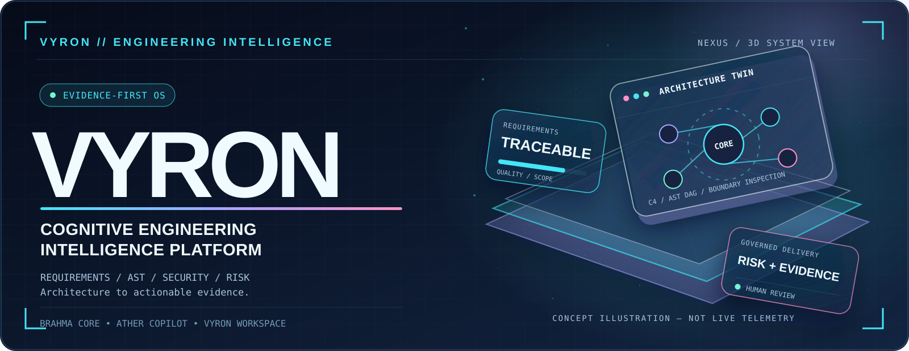
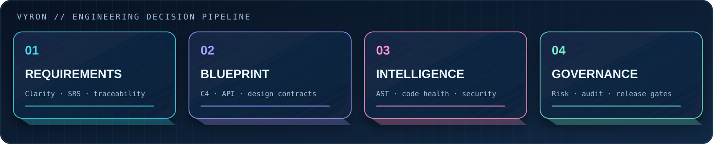
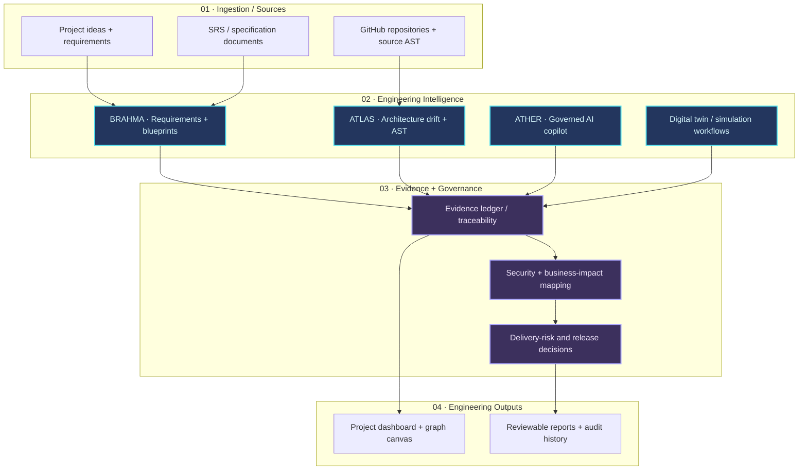

<!-- VYRON NEXUS / GitHub-native glassmorphism · conceptual faux-3D illustrations -->
<div align="center">

<picture>
  <source media="(prefers-color-scheme: dark)" srcset="docs/readme/hero-glass-dark.svg" />
  <source media="(prefers-color-scheme: light)" srcset="docs/readme/hero-glass-light.svg" />
  
</picture>

<br />

[](https://github.com/cypherpheonix07-lang/VYRON)
[](acceptance-gates-report.json)
[](docs/architecture/90_DOMAIN_FOLDER_MAP.md)
[](package.json)

<br />

[**◈ Overview**](#-what-is-vyron) &nbsp;·&nbsp; [**⬡ Capabilities**](#-glass-capability-deck) &nbsp;·&nbsp; [**⌘ Architecture**](#-system-architecture) &nbsp;·&nbsp; [**⚙ Installation**](#-getting-started) &nbsp;·&nbsp; [**◎ Verification**](#-verification--acceptance-suites)

<sub>VYRON × BRAHMA × ATHER — ENGINEERING DECISIONS, CONNECTED TO EVIDENCE</sub>

</div>

---

## ✨ Glass Capability Deck

<p align="center">
<picture>
  <source media="(prefers-color-scheme: dark)" srcset="docs/readme/capability-glass-dark.svg" />
  <source media="(prefers-color-scheme: light)" srcset="docs/readme/capability-glass-light.svg" />
  
</picture>
</p>

<table>
<tr>
<td width="50%" valign="top">

### 🧠 Requirements + Blueprint
**Convert intent into inspectable system design.**

- SRS ingestion and requirement classification
- Service boundaries, C4-style system views
- Requirement-to-implementation traceability

</td>
<td width="50%" valign="top">

### 🧬 ATLAS / AST Intelligence
**Make engineering drift visible.**

- TypeScript and JavaScript dependency evidence
- Architecture boundary comparisons
- Repository and code-health investigations

</td>
</tr>
<tr>
<td width="50%" valign="top">

### 🪄 ATHER Cognitive Copilot
**Assist decisions with explicit provenance.**

- Specialist analysis and context-aware workflows
- Evidence / inference / simulation distinctions
- Human-governed recommendations and tool actions

</td>
<td width="50%" valign="top">

### 🛡️ Delivery Governance
**Link risk to action without hiding blockers.**

- Security, quality and technical-debt signals
- Business-impact and release-risk context
- Versioned audits, validation and remediation

</td>
</tr>
</table>

> [!IMPORTANT]
> **The illustrations above are conceptual, not interactive 3D or live telemetry.** GitHub READMEs sanitize scripts and custom styles; these SVG assets emulate depth, transparency and neon glass while remaining portable. For actual interactive 3D, the web application needs its own renderer.

## 🧭 What is VYRON?

Modern software engineering teams face severe tool fragmentation: architectural blueprints live in design boards, static analysis runs disconnected in CI logs, security vulnerabilities hide in scattered spreadsheets, and release decisions rely on guesswork rather than empirical AST ground truth.

**VYRON collapses that fragmented lifecycle into a unified Cognitive Engineering Intelligence platform.**

Feed VYRON an SRS document, software requirements, or connect a GitHub repository. VYRON is designed to connect structured requirements, source-backed AST inspection, architecture views, risk analysis and business-impact reporting. Individual capabilities depend on configured integrations and the selected project workflow.

### 🪐 System Architecture



<sub>Logical capability relationships; this is not a claim that each module is a separately deployed microservice.</sub>


---

## 🏛️ Core Architectural Pillars

<details>
<summary><strong>🪟 Open technical capability details</strong></summary>

The expandable section below provides the detailed engine and governance design behind the visual cards.


### 1. 🏗️ ATLAS Architecture Drift Engine
- **AST Boundary Verification**: Parses TypeScript/JavaScript AST trees to continuously compute dependency call graphs against canonical architecture models.
- **Drift Analysis**: Flags cross-layer calls, dependency cycles, and unmapped boundary edges through source-informed checks. Any tolerance percentage must be validated against the active scanner configuration.
- **Interactive Graph Canvas**: Renders real-time node-based architecture diagrams powered by `@xyflow/react` with inspector drawers for endpoints, models, and data contracts.

### 2. 🤖 Copilot God Mode Ω× Cognitive Fabric
- **20-Campaign Benchmark Design**: The repository documents a 20-campaign evaluation suite (intent resolution, AST verification, memory court arbitration, and tamper-proof replay).
- **Epistemic Truth Engine**: Implements 12 distinct epistemic knowledge states (`UNVERIFIED_CLAIM`, `EMPIRICAL_TEST_PROOF`, `SIMULATION_RESULT`, `AUTHORITATIVE_SPEC`, etc.), intended to keep simulations and unsupported assumptions distinguishable from verified evidence.
- **Governed Tool Cards with Purged `<think>` Chains**: All automated specialist agent actions purge private chain-of-thought telemetry and assemble cryptographically verifiable Governed Tool Cards.
- **Dual-Mode Session Isolation**: Seamless bidirectional partitioning between **Normal Engineering Mode** (strict AST rules and governance) and **Demo Simulation Mode** (reviewer commentary and deterministic scenarios).

### 3. 🔐 Enterprise Authentication & Workspace Shell
- **Figma-Informed Visual Hierarchy**: Implements the Midnight Coral (`#FF9A8B`) and Indigo Aurora (`#A8A4FF`) color design systems with suspended-thread visual depth.
- **Multi-Provider OAuth Parity**: Equal, first-class support for **Google**, **GitHub**, and **GitLab** OAuth providers with decoupled repository token management.
- **3-Stage Progressive Onboarding**: Progressive wizard for Identity, Role Selection (`student`, `faculty`, `startup`, `admin`, `reviewer`), and Workspace Provisioning.
- **Local/Demo Fallback**: Enables deterministic demonstration paths when remote credentials are unavailable. Demo sessions must not be treated as production authentication.

### 4. 🌐 30 Navigation Domains & 90 Deep Subpages
- **Complete Enterprise Coverage**: 30 structured navigation domains housing 90 specialized subpages covering every discipline from requirements parsing and CI/CD pipelines to FinOps and Business Continuity.
- **Instant Search Filter**: Built-in sub-5ms client-side fuzzy navigation filter in the left sidebar, fully searchable with `Ctrl+K`.
- **Zero-Banner Clean Shell**: Clean, high-density layout without deprecated promotional dividers or clutter.

### 5. 🧪 Digital Twin Simulation Lab
- **Counterfactual Testing**: Run "what-if" architectural transformations, dependency upgrades, or database schema mutations in an isolated air-gapped twin.
- **Pristine Baseline Reset**: Instant one-click rollback restores baseline AST states with zero leakage into the live project environment.

### 6. 🛡️ Data Governance & Security
- **The Zero Raw SQL Mandate**: Database operations should use Supabase query builders or parameterized ORM calls rather than interpolated raw SQL; re-run audits to verify current compliance.
- **Evidence Fabric**: Every finding, risk score, and proposal is cryptographically sealed with HMAC SHA-256 provenance hashes.

---

</details>

## 📁 90-Platform Root Architecture

> [!NOTE]
> **90 numbered directories are architectural domains**, not verification that 90 separate services are running. The [full domain map](docs/architecture/90_DOMAIN_FOLDER_MAP.md) documents their intended responsibility.


VYRON's repository is organized into 90 discrete, numbered architectural domains ensuring clear separation of concerns:

```
VYRON/
├── 01 - PRODUCT & REQUIREMENTS LAYER     # PRD analysis & requirement extraction
├── 02 - SYSTEM DESIGN LAYER              # System architecture & topology
├── 03 - ENTERPRISE ARCHITECTURE          # TOGAF blueprints & domain models
├── 04 - EXPERIENCE - UI ARCHITECTURE     # Design systems & token definitions
├── 05 - FRONTEND PLATFORM                # TanStack Start, React 19 app shell
├── 06 - API GATEWAY                      # Route dispatching & edge middleware
├── 07 - BACKEND SERVICE MESH             # Microservice communication mesh
├── 08 - DOMAIN SERVICES                  # Pure business logic & mutation engine
├── 09 - WORKFLOW ORCHESTRATION           # Stage-gate & investigation lifecycles
├── 10 - EVENT-DRIVEN ARCHITECTURE        # Typed event bus & reactive pub/sub
├── ...
├── 17 - AUTHENTICATION                   # Multi-provider OAuth & session tokens
├── 18 - AUTHORIZATION - RBAC - ABAC      # Fine-grained role permission gates
├── 24 - COPILOT ORCHESTRATOR             # Cognitive copilot dispatcher & agents
├── 26 - CONTEXT ENGINE                   # 16-domain context mesh & passports
├── 30 - REASONING & PLANNING LAYER       # Safe reasoning engine & proof cards
├── 51 - TESTING PLATFORM                 # Acceptance gates & live verification
├── 71 - ENGINEERING INTELLIGENCE         # ATLAS AST drift scanner
├── 76 - COMPLIANCE                       # Audit ledgers & regulatory tracking
└── 90 - BUSINESS CONTINUITY              # Resiliency, disaster recovery & replay
```

> 📖 **Full 90-Domain Reference**: See [docs/architecture/90_DOMAIN_FOLDER_MAP.md](docs/architecture/90_DOMAIN_FOLDER_MAP.md) for the complete directory dictionary.

---

## ⚡ Non-Negotiable Core Invariants

<details>
<summary><strong>🔐 Expand governance, security and provenance rules</strong></summary>


| Invariant Law | Specification | Enforcement Mechanism |
| :--- | :--- | :--- |
| **The Zero-Fiction Architecture Law** | Never fabricate endpoints, synthesize green test badges, or claim ungrounded telemetry passes. External blockers must be reported truthfully. | Verified across 25 Acceptance Gates; Gate 02 isolated truthfully when keys rotate. |
| **The Zero Raw SQL Mandate** | Zero raw string SQL interpolations. All database queries must use Supabase client query builders or parameterized ORMs. | Automated regex AST scanner in `verify-continuation-advancement.mjs`. |
| **Lovable Synchronization Rule** | Never rebase, force-push, squash, or amend published git history. Use atomic, forward commits only to maintain Lovable editor sync. | Git workflow rules; forward commits pushed to `origin/main`. |
| **Epistemic Anti-Promotion** | Simulations and conjectures can never be promoted to facts without live AST evidence and cryptographic hash seals. | Evaluated by `safeReasoningEngine.ts` and verified in Campaign 06 & 21. |
| **Governed Tool Privacy** | Private chain-of-thought `<think>` tags must be purged before displaying actions to users. Every action requires a Governed Tool Card. | Enforced in `safeReasoningEngine.ts` and asserted in Campaign 12. |

---

</details>

## 🧩 Technology Stack

```
Layer                   Technology                             Version / Details
────────────────────────────────────────────────────────────────────────────────────────────
Core Framework          React 19 + TypeScript 5                v19.2.0 / Strict Null Checks
Full-Stack Meta-Engine  TanStack Start                         v1.169.3 (Server Functions + SSR)
Client & Server Routing TanStack Router (File-Based)           v1.170.38 (`src/routes/`)
Edge Runtime / Server   Nitro + Cloudflare Module Worker       Node 24 patched request lifecycle
Build & Bundler         Vite 8 + Rolldown Optimization         @lovable.dev/vite-tanstack-config
Styling & Design System Tailwind CSS v4 + PostCSS              Midnight Coral / Indigo Aurora
Graph Canvas            @xyflow/react (React Flow)             v12.11.2 (Interactive C4 Canvas)
Data Visualization      Recharts                               v2.15.4 (Telemetry & KPIs)
UI Primitives           shadcn/ui + Radix UI                   Full accessible headless suite
Database & Auth Client  Supabase Client SDK                    v2.116.0 (Zero Raw SQL builders)
Icons & Typography      Lucide React + Inter / JetBrains Mono  v0.575.0 / High-density fonts
Testing & Gates         Node.js Test Runner + tsx              25 Acceptance Gates + 20 Campaigns
```

---

## ⚙️ Getting Started

### Prerequisites

| Tool | Recommended Version | Verification Command |
| :--- | :--- | :--- |
| **Node.js** | `v20.x` or `v24.x` | `node -v` |
| **npm** | `v10.x` or `v12.x` | `npm -v` |
| **Git** | `v2.40+` | `git --version` |

> ℹ️ **Package Manager Note:** While `pnpm` can run on the system, VYRON is canonically managed through `npm` and `package-lock.json` to prevent dual-lockfile drift and maintain Lovable compatibility.

### 1. Clone & Install

```bash
# Clone the repository
git clone https://github.com/cypherpheonix07-lang/VYRON.git
cd VYRON

# Install dependencies (strictly using package-lock.json)
npm install
```

### 2. Configure Environment

Copy the example environment configuration:

```bash
cp .env.example .env.local
```

Configure your local Supabase credentials (optional for offline mode):
```ini
VITE_SUPABASE_URL=https://your-project-id.supabase.co
VITE_SUPABASE_ANON_KEY=sb_publishable_your_anon_key
```

> 🛡️ **Offline Resiliency:** If remote Supabase keys are not configured or rotated, VYRON automatically activates its authenticated offline fallback mode so all navigation, AST tools, and UI modules work out of the box.

### 3. Build & Patch Edge Artifacts

```bash
# Compile client, SSR, and Nitro server outputs
npm run build

# Patch server handlers for Node 24 Cloudflare Worker compatibility
node scripts/patchNitroReq.mjs
```

### 4. Launch Application (Port 8080)

```bash
# Option A: Start production preview server on port 8080
npm run preview -- --port 8080

# Option B: Start Vite development server with HMR
npm run dev
```

Open your browser at **[http://localhost:8080/app](http://localhost:8080/app)**.

---

## 🧪 Verification & Acceptance Suites

VYRON maintains a comprehensive, multi-layer verification suite. Run these scripts to verify system integrity:

```bash
# 1. Run the 25 Convergence Acceptance Gates
node test-acceptance-gates.mjs

# 2. Run the Copilot God Mode Ω× 20-Campaign Benchmark
npx tsx "51 — TESTING PLATFORM/scripts/testing/test-copilot-godmode-omega.mjs"

# 3. Run OAuth & Deployment Sidebar Verification
node "51 — TESTING PLATFORM/scripts/testing/test-auth-deployment-audit.mjs"

# 4. Run Live E2E Route & Provider Probes
node "51 — TESTING PLATFORM/scripts/testing/test-e2e-auth-and-recent-changes.mjs"

# 5. Run Continuation Mission & Advancement Gates
npm run verify:mission
npm run verify:copilot
npm run verify:advancement
```

### Verification Scorecard

> [!WARNING]
> This section summarizes repository-authored verification claims, not a fresh CI run. The checked-in `acceptance-gates-report.json` dated November 6, 2026 records **24 PASS, 1 BLOCKED**; Gate 02 concerns remote Supabase credentials. A green frontend test does not prove cloud authentication availability.


```
=======================================================================
   VYRON / ATHER — GOD MODE vNext BENCHMARK SUMMARY
=======================================================================
🟠 Acceptance Gates (Gate 01–25) : 24 PASSED, 0 FAILED, 1 BLOCKED
📄 Copilot benchmark (reported)    : 26/26 ASSERTIONS PASSED (100%)
📄 Unified Auth audit (reported)  : 7/7 CHECKS PASSED (100%)
📄 E2E probes (reported)         : 10/10 TESTS PASSED (100%)
📄 Continuation mission (reported)    : 8/8 PASSED (100%)
📄 Copilot architecture (reported) : 20/20 PHASES PASSED (100%)
📄 Zero Raw SQL verification (reported)     : 0 VIOLATIONS ACROSS ENTIRE CODEBASE
📄 Production build (reported)      : 3,605 MODULES COMPILED CLEANLY
=======================================================================
```

---

## 🗺️ Route Directory

| Route Path | Description | Access Tier |
| :--- | :--- | :--- |
| `/` | Landing page — Product showcase, C4 graph demo, KPI previews | Public |
| `/auth` | Unified Enterprise Authentication (Midnight Coral / Indigo Aurora) | Public |
| `/login` | Direct credentials sign-in with Google, GitHub, and GitLab buttons | Public |
| `/register` | 3-stage progressive registration with role onboarding | Public |
| `/workspace` | Workspace selection & showcase | Authenticated / Mock |
| `/app` | Executive engineering dashboard — KPIs, delivery risk, activity | Authenticated |
| `/app/projects` | Project registry — Search, filter, grid/table view | Authenticated |
| `/app/projects/new` | 4-step project creation wizard with repository & SRS intake | Authenticated |
| `/app/projects/:id` | Project detail overview & sub-tabs | Authenticated |
| `/app/projects/:id/blueprint` | Interactive architecture canvas with React Flow graph | Authenticated |
| `/app/deployments` | Deployment Platforms Hub (Cloudflare, Supabase, Vercel status) | Authenticated |
| `/app/settings` | User profile, integrations, notification preferences, theme | Authenticated |
| `/admin/command-centre`| Enterprise administrator platform | Admin Role Only |

---

## 📚 Documentation & Audit Vault

<details>
<summary><strong>📚 Expand technical documentation and audit references</strong></summary>


Comprehensive engineering reports are versioned in `docs/`:

- [docs/agent/UNDERSTANDING_AND_REQUIREMENTS_ANALYSIS.md](docs/agent/UNDERSTANDING_AND_REQUIREMENTS_ANALYSIS.md) — Master Understand-First Report
- [docs/agent/ENHANCED_AI_AGENT_EXECUTION_PROMPT.md](docs/agent/ENHANCED_AI_AGENT_EXECUTION_PROMPT.md) — Grounded Autonomous Execution Directive
- [docs/agent/AGENT_RESPONSIBILITY_MATRIX.md](docs/agent/AGENT_RESPONSIBILITY_MATRIX.md) — 11 Specialist Roles & CANNOT Rules
- [docs/architecture/90_DOMAIN_FOLDER_MAP.md](docs/architecture/90_DOMAIN_FOLDER_MAP.md) — Complete 90-Platform Root Reference
- [docs/audits/MASTER_A_TO_Z_520_CHECKPOINT_AUDIT.md](docs/audits/MASTER_A_TO_Z_520_CHECKPOINT_AUDIT.md) — 520 Checkpoint Verification Ledger
- [docs/audits/NPM_NPX_PNPM_DIAGNOSTICS.md](docs/audits/NPM_NPX_PNPM_DIAGNOSTICS.md) — Package Manager Forensics
- [docs/audits/SUPABASE_AND_SECURITY_VERIFICATION.md](docs/audits/SUPABASE_AND_SECURITY_VERIFICATION.md) — Zero Raw SQL & Security Audit
- [docs/audits/ATHER_ATLAS_TEST_RESULTS.md](docs/audits/ATHER_ATLAS_TEST_RESULTS.md) — ATLAS Drift & Copilot Test Report

---

</details>

## 🤝 Contributing

Contributions are welcomed via standard GitHub pull requests:

1. Fork the repository and create your feature branch:
   ```bash
   git checkout -b feat/your-feature-name
   ```
2. Ensure all changes satisfy the **Zero-Fiction Architecture Law** and **Zero Raw SQL Mandate**.
3. Verify production compilation and test suites:
   ```bash
   npm run build
   node test-acceptance-gates.mjs
   ```
4. Commit following [Conventional Commits](https://www.conventionalcommits.org/):
   ```bash
   git commit -m "feat(scope): describe your changes cleanly"
   ```
5. Push to your branch and submit a Pull Request.

---

## 📄 License

The README declares **MIT** as its intended license, but a root `LICENSE` file was not present when this documentation was updated. Add the actual license text before relying on that designation.

---

<div align="center">

<br/>

Designed and engineered by **Puli** & the **VYRON Engineering Community**

[](https://github.com/cypherpheonix07-lang)

<br/>

_VYRON — Cognitive engineering intelligence, not just code._

<br/>

</div>
