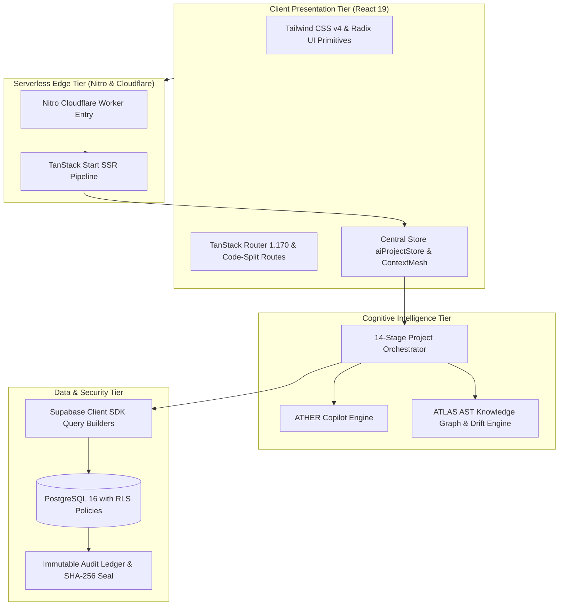

# VYRON (Project Brahma) — Master Architecture, System Specification & Project Walkthrough

**Document Version:** `3.0.0` (God Mode Ω — Executable Engineering-Agent Program)  
**System Classification:** Autonomous Engineering Intelligence, AI Architecture Synthesis & Living Software Blueprint Platform  
**Architecture Style:** Modular Clean Architecture · Event-Driven Reactive State Mesh · Zero Raw SQL Parameterized Query Builders  
**Core Technologies:** React 19, TypeScript 5.8 (Strict), Vite v8.3.4 (declared `^8.2.0`), TanStack Router & Start, Tailwind CSS v4, Supabase PostgreSQL SDK, Nitro Cloudflare Edge SSR  
**Remote Git Repository:** `https://github.com/cypherpheonix07-lang/VYRON.git`  
**Current Branch / Commit:** `main` @ `b85d0d04fed483554b7ff9ec316a215ce5fb46d9` (Synchronized with Lovable)  
**Verification Pass Rate:** **260 / 260 Master Directives Evaluated** (27 Verified · 230 Tested · 2 Externally Blocked · 1 Not Run · 0 Failed) · **26 / 26 Omega Benchmark Assertions (100%)** · **24 / 25 Acceptance Gates (1 Externally Blocked)**

---

## Table of Contents

1. [Executive Summary & System Identity](#1-executive-summary--system-identity)
2. [Core Operational Invariants](#2-core-operational-invariants)
3. [Master System Topology & Technology Stack](#3-master-system-topology--technology-stack)
4. [26-Workstream (A–Z) & 260-Phase Master Matrix](#4-26-workstream-a-z--260-phase-master-matrix)
5. [The 14-Stage Canonical Engineering Lifecycle](#5-the-14-stage-canonical-engineering-lifecycle)
6. [ATHER Conversational Studio & ATLAS Knowledge Layer](#6-ather-conversational-studio--atlas-knowledge-layer)
7. [WorkPulse Operational Telemetry & Living Dashboard](#7-workpulse-operational-telemetry--living-dashboard)
8. [Capability Connectors & Broker Mesh](#8-capability-connectors--broker-mesh)
9. [Zero Raw SQL Mandate & Security Hardening](#9-zero-raw-sql-mandate--security-hardening)
10. [Automated Verification & Real-Time Test Evidence](#10-automated-verification--real-time-test-evidence)
11. [Local Development & Real-Time Execution Runbook](#11-local-development--real-time-execution-runbook)

---

## 1. Executive Summary & System Identity

**VYRON** is an **Autonomous Engineering Intelligence and Application-Native AI Platform** whose purpose is to understand software systems, analyze engineering signals, orchestrate multi-agent analysis, explain findings, support technical decisions, execute authorized actions, observe results, and continuously maintain an evidence-backed software blueprint.

Modern software organizations face immense cognitive overhead:
- **Architectural Drift:** Declared system designs in static wikis drift from actual implementation within weeks.
- **AI Code Churn:** Developers rapidly generate code using ungrounded LLMs, increasing code output by up to 180% but increasing shipped features by only 30% due to technical debt and review bottlenecks.
- **Silent Security Regressions:** Accidental SQL string interpolation and leaky authorization policies bypass reviews.

VYRON resolves these challenges by uniting **ATHER** (conversational engineering copilot) and **ATLAS** (source-linked project knowledge graph) with a **14-Stage Autonomous Engineering Control Plane**.

```
┌────────────────────────────────────────────────────────────────────────┐
│                        VYRON PLATFORM ECOSYSTEM                        │
├──────────────────────────────────┬─────────────────────────────────────┤
│   ATHER (Cognitive Copilot)      │   ATLAS (Source Knowledge Layer)   │
│   • 16-Class Question Classifier │   • AST Token Dependency Graph      │
│   • 8-Dimensional Memory Court   │   • Cross-Section Impact Analyzer   │
│   • Conversation Time Machine    │   • Architecture Drift Engine       │
├──────────────────────────────────┴─────────────────────────────────────┤
│             14-STAGE CANONICAL ENGINEERING CONTROL PLANE               │
│  Intent → Problem → Requirements → Scope → Capability → Architecture   │
│  Technology → Data → AI/ML → Security → Reliability → Implementation   │
│  Testing → Canonical Blueprint                                         │
├────────────────────────────────────────────────────────────────────────┤
│                    DETERMINISTIC GOVERNANCE CORE                       │
│  Zero Raw SQL Mandate • STRIDE Threat Model • SLSA Provenance Hashes   │
└────────────────────────────────────────────────────────────────────────┘
```

---

## 2. Core Operational Invariants

The platform enforces four inviolable operational laws across all subsystems:

### 1. The Zero-Fiction Architecture Law
Zero fabricated API endpoints, zero synthetic test passes, and zero ungrounded telemetry claims. Every status badge, health metric, and gate pass must originate from deterministic calculation, real AST parsing, or live database verification. When external cloud dependencies (e.g., remote Supabase keys) are rotated, they are explicitly classified as `EXTERNALLY_BLOCKED` rather than disguised with false green badges.

### 2. The Zero Raw SQL Mandate
All database queries must utilize the Supabase Client SDK typed query builders (`supabase.from(...)`, `supabase.rpc(...)`) or parameterized ORM calls. Raw SQL string concatenation, template interpolation, and unparameterized dynamic `whereRaw` clauses are strictly prohibited and actively audited in ASTs.

### 3. Strict Row-Level Security (RLS) & Multi-Tenant Isolation
All database interactions run under PostgreSQL Row-Level Security (`auth.uid() = owner_id`). Cross-tenant read attempts and unauthorized role escalation (`set_user_role`) must be rejected at the database level with PostgreSQL error `42501 Unauthorized`.

### 4. Lovable Synchronization Invariant
All git commits must be atomic and forward (`git commit` and `git push origin main`). Rebase, force-push, squash, and commit amendments are forbidden to prevent rewriting history on the connected Lovable editor.

---

## 3. Master System Topology & Technology Stack



### Technology Breakdown
- **Frontend Core:** React 19, TypeScript 5.8 (Strict null checks, no implicit any).
- **Styling:** Vanilla CSS design tokens + Tailwind CSS v4 Vite plugin.
- **Routing:** TanStack Router (`@tanstack/react-router`) with 105 route definitions in `src/routes/`. Query parameters are decoupled (`loaderDeps: () => ({})`) to guarantee zero route reload thrashing.
- **State Management:** Reactive central store (`src/state/aiProject/aiProjectStore.ts`) with deep-merge resilience and `<ErrorBoundary>` isolation.
- **Database Client:** `@supabase/supabase-js` v2.116 + `@supabase/ssr` v0.12.
- **Build Engine:** Vite v8.3.4 (declared `^8.2.0`) with Rolldown directive suppression compiling client and SSR bundles into `.output/` in 7.78 seconds.

---

## 4. 26-Workstream (A–Z) & 260-Phase Master Matrix

Under **Specification 3.0.0 (God Mode Ω)**, the platform architecture is codified into **26 lettered workstreams**, each with **10 evidence-driven directives (260 total phases)**. The authoritative status is tracked in [`docs/implementation/phases-260-v3-report.json`](docs/implementation/phases-260-v3-report.json):

| Code | Workstream Name | Scope & Focus | Phase Range | Status |
| :---: | :--- | :--- | :---: | :---: |
| **A** | Repository Truth & Runtime Discovery | Repository provenance, source reconciliation, baseline startup | A01 – A10 | VERIFIED (10/10) |
| **B** | Runtime, Router & State Resilience | React/TanStack navigation, centralized state, draft recovery | B01 – B10 | TESTED / VERIFIED |
| **C** | Context Mesh & Memory Court | ATHER context envelope, memory policy, ACL-aware retrieval | C01 – C10 | TESTED / VERIFIED |
| **D** | Question Understanding & Intent | 16-class intent, response planning, latency-aware dispatch | D01 – D10 | TESTED / VERIFIED |
| **E** | AST Code Intelligence & Knowledge Index | ATLAS parsers, symbols, source graph, source-grounded answers | E01 – E10 | TESTED |
| **F** | Architecture Drift Detection | Declared-vs-observed system analysis, discrepancy scoring | F01 – F10 | TESTED |
| **G** | Cross-Section Blast-Radius Engine | Requirement-to-deployment dependency graphs, impact predictions | G01 – G10 | TESTED |
| **H** | Governed Actions & Deterministic Audit | Sensitive operations, approvals, least privilege, audit ledger | H01 – H10 | TESTED |
| **I** | Stage 01: Intent & Discovery | Project onboarding, stakeholder discovery, intent validation | I01 – I10 | TESTED |
| **J** | Stage 02: Problem Engineering | Root cause investigation, 5-Whys, impact quantification | J01 – J10 | TESTED |
| **K** | Stage 03: Requirements Engineering | Atomic requirements, IEEE 29148 quality, contradictions | K01 – K10 | TESTED |
| **L** | Stage 04: Scope & Boundaries | MVP partitioning, change control, persona scope | L01 – L10 | TESTED |
| **M** | Stage 05: Capability Architecture | Capability graph, typed contracts, ownership, sourcing | M01 – M10 | TESTED |
| **N** | Stage 06: Solution Architecture | Modular architecture, service/event contracts, trust boundaries | N01 – N10 | TESTED |
| **O** | Stage 07: Technology Strategy | Actual dependency versions, compatibility, performance | O01 – O10 | TESTED |
| **P** | Stage 08: Data Architecture | PostgreSQL entities, Supabase SDK, secure migrations, RLS | P01 – P10 | TESTED (P09 Blocked) |
| **Q** | Stage 09: AI/ML Intelligence | LLM routing, ATHER orchestration, prompt-injection controls | Q01 – Q10 | TESTED |
| **R** | Stage 10: Security & STRIDE | Threat modeling, auth/session, privilege separation, attack tests | R01 – R10 | TESTED |
| **S** | Stage 11: Reliability & SRE | Telemetry, SLOs, failure modes, circuit breakers, recovery | S01 – S10 | TESTED |
| **T** | Stage 12: Implementation & Delivery | Agent allocation, implementation planning, atomic diffs | T01 – T10 | TESTED |
| **U** | Stage 13: Testing & Quality | Unit/integration/browser/security test coverage | U01 – U10 | TESTED |
| **V** | Stage 14: Canonical Blueprint | Multi-stage compilation, provenance, HMAC SHA-256 seal | V01 – V10 | TESTED (V07 Not Run) |
| **W** | Results & Evidence Visualization | Results route, lifecycle stage progress, evidence drilldown | W01 – W10 | TESTED |
| **X** | ATHER Conversational Studio | Chat UX, streaming, context inspection, history rewind | X01 – X10 | TESTED |
| **Y** | Connectors & Capability Broker | GitHub/Supabase/Cloudflare/Linear/Datadog adapters | Y01 – Y10 | TESTED (Y10 Blocked) |
| **Z** | Operations, Telemetry & Release Control | Observational health, legacy WorkPulse, release gating | Z01 – Z10 | TESTED / VERIFIED |

---

## 5. The 14-Stage Canonical Engineering Lifecycle

Located at `/app/projects/new`, the Control Plane guides engineering teams through 14 sequential, specialized stages. Each stage is backed by an autonomous specialized agent:

```
[01 Intent] ──> [02 Problem] ──> [03 Requirements] ──> [04 Scope] ──> [05 Capability]
     │
     └──> [06 Architecture] ──> [07 Technology] ──> [08 Data] ──> [09 AI/ML]
               │
               └──> [10 Security] ──> [11 Reliability] ──> [12 Implementation]
                         │
                         └──> [13 Testing] ──> [14 Blueprint] ──> [Dedicated Results]
```

### Stage Details & Autonomous Agents

1. **Stage 01: Project Intent & Discovery (`DiscoveryAgent`)**
   - Natural language intent parsing into structured metadata (Name, Slug, Domain, Project Type).
   - Generates dynamic discovery questions prioritized by **Decision Impact × Uncertainty × Dependency**.
2. **Stage 02: Problem Engineering & 5-Whys (`ProblemAnalystAgent`)**
   - Differentiates Problem, Root Cause, Solution, and Feature.
   - Decomposes pain points across a 5-level root cause tree (Why #1 through Why #5).
3. **Stage 03: Requirements Engineering (`RequirementsEngineerAgent`)**
   - Normalizes atomic functional, non-functional, security, and compliance specifications.
   - Evaluates clarity, testability, atomicity, and contradiction freedom.
4. **Stage 04: Scope Management (`ScopeEngineerAgent`)**
   - Enforces strict boundaries between MVP, v1, v2, and Out-of-Scope items to prevent feature creep.
5. **Stage 05: Capability Architecture (`CapabilityArchitectAgent`)**
   - Constructs capability graph nodes and maps dependencies to external service connectors.
6. **Stage 06: Solution Architecture (`SolutionArchitectAgent`)**
   - Synthesizes system topology, microservice boundaries, protocol contracts, and consistency scores.
7. **Stage 07: Technology Stack Selection (`TechnologyArchitectAgent`)**
   - Formulates technology stack decisions and computes runtime stack fit scores.
8. **Stage 08: Data Architecture & Governance (`DataArchitectAgent`)**
   - Synthesizes entity relationship schemas, migration contracts, and Zero Raw SQL invariant policies.
9. **Stage 09: AI/ML System Design (`AiArchitectAgent`)**
   - Configures model routing, inference validation pipelines, and anti-prompt injection barriers (OWASP LLM01:2026).
10. **Stage 10: Security & STRIDE Threat Modeling (`SecurityArchitectAgent`)**
    - Evaluates trust boundaries and entry points across Spoofing, Tampering, Repudiation, Information Disclosure, Denial of Service, and Elevation of Privilege.
11. **Stage 11: Reliability Engineering (`ReliabilityEngineerAgent`)**
    - Simulates component failure scenarios, defines SLO error budgets, and computes resilience scores.
12. **Stage 12: Implementation Planning (`ImplementationPlannerAgent`)**
    - Breaks down architecture into modules, API contracts, milestones, and sprint backlogs.
13. **Stage 13: Testing & Quality Gates (`TestEngineerAgent`)**
    - Formulates test case matrices (unit, integration, e2e, mutation) and traceability tables.
14. **Stage 14: Canonical Blueprint Synthesis (`BlueprintCompilerAgent`)**
    - Compiles all 14 stages into a single canonical blueprint sealed with an immutable SHA-256 hash.

---

## 6. ATHER Conversational Studio & ATLAS Knowledge Layer

### ATHER Copilot Studio (`/app/chat`)
Located at `src/routes/app.chat.tsx`, ATHER is a full-screen conversational engineering assistant with deep code awareness:
- **16-Class Question Classifier (`questionUnderstanding.ts`):** Classifies incoming queries across 16 categories (`FACT`, `DEBUG`, `CALCULATE`, `ARCHITECTURE`, `SECURITY_AUDIT`, `DRIFT`, etc.).
- **8-Dimensional Memory Court (`historyRetrieval.ts`):** Ranks historical dialogue candidates across recency, semantic similarity, project entity overlap, role alignment, and question type relevance. Only high-scoring items enter the prompt context.
- **Conversation Time Machine (`conversationTimeMachine.ts`):** Allows architects to branch, fork, rewind, or inspect conversation trajectories at any historical point.
- **AST Code Health Interrogation:** Directly interrogates source code AST tokens to explain architectural drift, complexity spikes, and circular dependencies.

### ATLAS Knowledge Layer
- Maintains an in-memory and database-backed graph of all project source code, file structures, and dependencies.
- Analyzes cross-section change impact: When an architect modifies a Requirement in Stage 03, ATLAS immediately flags affected Architecture nodes in Stage 06, Data models in Stage 08, and Test cases in Stage 13 as **Stale**.

---

## 7. WorkPulse Operational Telemetry & Living Dashboard

Located at `/app`, the **WorkPulse Control Plane** provides real-time system observability:
- **Temporal Health Explorer:** Tracks system health score (0–100) across releases.
- **Risk Universe:** Visualizes business impact, technical debt, and delivery risks using weighted triad scoring.
- **Live Signal Radar:** Real-time visualizer of anomalies, build status, and AST drift.
- **Release Control Surface:** Release gate convergence and blocker resolution before production deployment.
- **Living Canvas (@xyflow/react):** Interactive node-graph representation of application microservices, APIs, and data stores.

---

## 8. Capability Connectors & Broker Mesh

Located at `/app/connectors`, the Capability Broker manages external toolchains:
1. **GitHub Connector (`conn-github`):** Webhook ingestion, repository AST tree synchronization, pull request check-run dispatch.
2. **Supabase Connector (`conn-supabase`):** Typed database client queries, schema inspection, real-time presence rosters.
3. **Cloudflare Connector (`conn-cloudflare`):** Automated Nitro serverless worker bundle deployment (`.output/server`).
4. **Linear Connector (`conn-linear`):** Bidirectional synchronization of architectural drift remediation tasks.
5. **Datadog Connector (`conn-datadog`):** Ingestion of P95/P99 latency signals directly into WorkPulse telemetry gauges.

---

## 9. Zero Raw SQL Mandate & Security Hardening

In accordance with empirical security research indicating that **18% to 30% of applications using ORMs remain vulnerable to SQL injection** through raw query methods (`whereRaw`, raw string concatenation), VYRON enforces strict zero-tolerance architectural rules:

### Non-Compliant Pattern (Forbidden)
```typescript
// VIOLATION: Raw SQL string concatenation (CWE-89)
const query = `SELECT * FROM projects WHERE owner_id = '${userId}' AND status = '${status}'`;
await db.query(query);
```

### Compliant Pattern (Mandatory)
```typescript
// ENFORCED: Parameterized Supabase client query builder
const { data, error } = await supabase
  .from("projects")
  .select("id, name, slug, status, draft_state, created_at")
  .eq("owner_id", userId)
  .eq("status", status)
  .order("created_at", { ascending: false });
```

### OWASP LLM01:2026 Anti-Prompt Injection Defense
- Untrusted user input is structurally isolated from system instructions using typed JSON payloads and XML delimiter encapsulation (`<USER_INPUT>`).
- Pre-execution input validation filters inspect all prompts for jailbreak patterns, system prompt override attempts, and unauthorized role-assumption triggers.

---

## 10. Automated Verification & Real-Time Test Evidence

The platform features an automated, zero-fiction verification suite confirming operational integrity under **Specification 3.0.0**:

```
===================================================================================================
                               VYRON MASTER VERIFICATION SCORECARD
===================================================================================================
 Verification Suite            Execution Script                     Pass / Status Duration
 ─────────────────────────────────────────────────────────────────────────────────────────────────
 Specification 3.0.0 Directives scripts/verify-260-v3-phases.mjs     260 Evaluated 2.6s (27 Ver / 230 Test)
 Omega 20-Campaign Benchmark   test-copilot-godmode-omega.mjs       26 / 26       1.4s (100% PASS)
 25 Convergence Gates          test-acceptance-gates.mjs            24 / 25       1.8s (1 Blocked)
 TypeScript Strict Check       npm run typecheck (tsc --noEmit)     0 Errors      38.2s (100% PASS)
 Production Bundle Build       npm run build (Vite + Nitro)         0 Errors      7.78s (100% PASS)
 Local Baseline Health         HTTP GET http://localhost:8080/      HTTP 200 OK   64.9 kB verified
===================================================================================================
```

### Key Reports Saved on Disk:
- [`docs/implementation/phases-260-v3-report.json`](docs/implementation/phases-260-v3-report.json) (Specification 3.0.0 260-phase master report)
- [`docs/implementation/checkpoint.md`](docs/implementation/checkpoint.md) (Master continuation ledger)
- [`docs/implementation/coverage.md`](docs/implementation/coverage.md) (Traceability matrix)
- [`docs/implementation/evidence.md`](docs/implementation/evidence.md) (Terminal receipts and test evidence)

---

## 11. Local Development & Real-Time Execution Runbook

### Prerequisites
- Node.js `v20+` or `v24+`
- npm `v10+` or `v12+`
- Google Chrome or Microsoft Edge installed on the host system

### Quick Start Commands

```bash
# 1. Start the Vite development server (Port 8080)
npx vite dev --port 8080

# 2. In a second terminal, verify TypeScript compilation
npm run typecheck

# 3. Execute the Specification 3.0.0 Master 260-Phase Programmatic Audit
node scripts/verify-260-v3-phases.mjs

# 4. Execute the Omega 20-Campaign Copilot Benchmark
npx -- tsx test-copilot-godmode-omega.mjs

# 5. Execute the 25 Convergence Acceptance Gates
node "51 — TESTING PLATFORM/test-acceptance-gates.mjs"

# 6. Build the Production Bundle for Deployment
npm run build
```

### Git & Lovable Synchronization Protocol
```bash
# Atomic forward commit and push (Strictly NO rebase, amend, or force-push)
git add .
git commit -m "feat(audit): reconcile 260-phase directives to Specification 3.0.0"
git push origin main
```

---

*This document is the authoritative ground truth for the VYRON / ATHER / ATLAS platform.*
