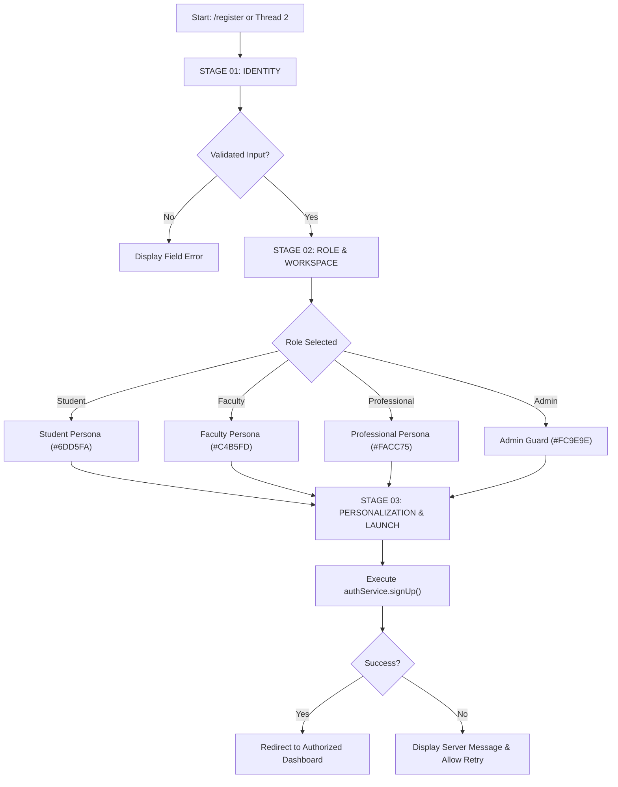

# THREE-STAGE ONBOARDING & WORKSPACE SELECTION FLOW

**Project**: VYRON / ATHER — Engineering Intelligence Platform  

---

## 1. Multi-Step Onboarding Architecture

---

## 2. Role Authorization Boundaries (Zero-Fiction)

1. **Student Role**:
   - Primary Focus: Learning, prototyping, SRS requirements, and architecture modeling.
   - Default Route: `/dashboard/student`
2. **Faculty Role**:
   - Primary Focus: Student progress ledgers, milestone review, and rubric assessments.
   - Default Route: `/dashboard/faculty`
3. **Working Professional Role**:
   - Primary Focus: Production systems, AST forensics, architecture drift, release verification.
   - Default Route: `/dashboard/professional`
4. **Administrator Role**:
   - Primary Focus: Organization settings, platform telemetry, policy-as-code, audit ledger.
   - Default Route: `/admin/command-centre`
   - **Security Invariant**: Client-side selection of Admin role alone NEVER grants administrative rights; server-side profile verification is strictly enforced by `useAuth()` and backend RLS policies.
