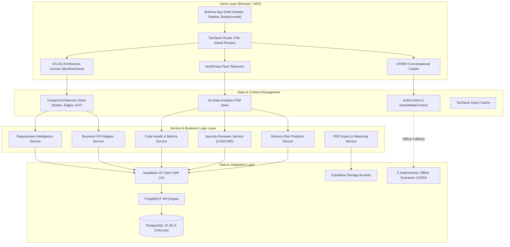
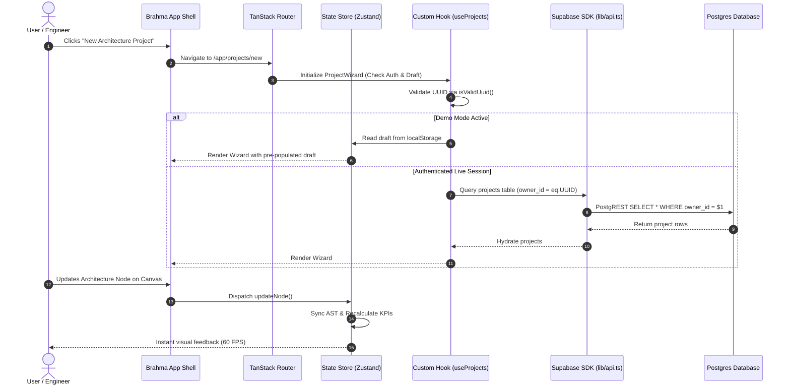
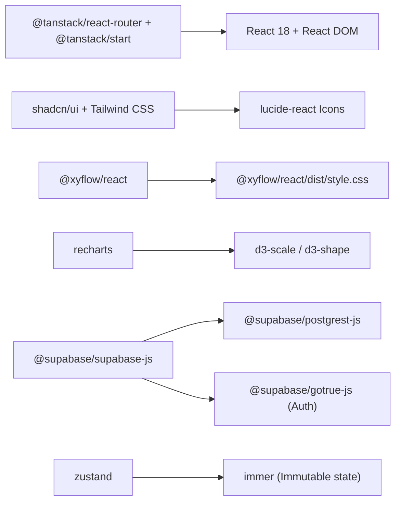

# 08 — ARCHITECTURE AND DEPENDENCY GRAPH
**Project:** VYRON / PROJECT BRAHMA v2.0  
**Repository Working Directory:** `C:\Users\Phanindra\OneDrive\Desktop\PANDU-FINAL YEAR PROJECTS\PROJECT-VYRON\VYRON-main`  
**Git Remote:** `origin` -> `https://github.com/cypherpheonix07-lang/VYRON.git` (`main`)  
**Timestamp:** 2026-11-01T17:13:00+05:30  
**Classification:** `ARCHITECTURE & TOPOLOGY`  

---

## 1. System Topology Overview

VYRON / PROJECT BRAHMA v2.0 utilizes a modular modern architecture powered by TanStack Start with Vite 8 and Nitro SSR on the frontend, coordinating with Supabase PostgreSQL and Edge Functions on the backend, styled with Tailwind CSS and shadcn/ui primitives.

---

## 2. High-Level Component & Service Topology

---

## 3. Data Flow & Request Lifecycle

---

## 4. Package Dependency Graph & Module Hierarchy

---

## 5. Security & Isolation Boundaries

1. **Authentication Boundary**: All routes beneath `/app/*` and `/dashboard/*` are encapsulated by `<ProtectedRoute>` which checks the active session in `AuthContext`. Unauthenticated requests redirect to `/login?next=<path>`.
2. **Postgres RLS Boundary**: Every table in Supabase (`projects`, `profiles`, `analyses`, `findings`, `proposals`) enforces Row Level Security based on `auth.uid() = owner_id`.
3. **Demo Mode Boundary**: Demo users receive isolated mock state and are prevented from transmitting malformed queries (such as non-UUID identifiers) to Postgres.
4. **Secret Isolation Boundary**: All sensitive keys remain isolated on the server; client bundles contain zero private credentials.
