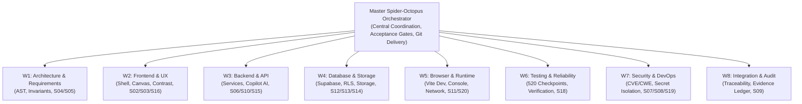

# 11 — MULTI-AGENT EXECUTION PLAN (SPIDER–OCTOPUS MODEL)
**Project:** VYRON / PROJECT BRAHMA v2.0  
**Repository Working Directory:** `C:\Users\Phanindra\OneDrive\Desktop\PANDU-FINAL YEAR PROJECTS\PROJECT-VYRON\VYRON-main`  
**Git Remote:** `origin` -> `https://github.com/cypherpheonix07-lang/VYRON.git` (`main`)  
**Timestamp:** 2026-11-01T17:15:00+05:30  
**Classification:** `MULTI-AGENT ORCHESTRATION PROTOCOL`  

---

## 1. Orchestration Model Overview

The **Spider–Octopus** multi-agent model establishes a coordinated engineering hierarchy within Google Antigravity. It couples one central master orchestrator with up to eight scoped specialist workers. 

While workers conduct parallel read-only discovery, static analysis, and isolated scenario testing, authoritative state mutation and sequential section acceptance (S01 through S20) remain strictly centralized to prevent merge collisions and data races.

---

## 2. Multi-Agent Topology

---

## 3. Worker Profiles & Scoped Responsibilities

| Worker ID | Specialist Role | Primary Modules | Bounded File Scope | Authority Level |
|---|---|---|---|---|
| **W1-ARCH** | Architecture & Requirements | S04, S05 | `src/services/requirementService.ts`, `src/components/requirements/` | Read / Analyze / Draft |
| **W2-UI** | Frontend & UX Specialist | S02, S03, S16 | `src/components/ui/`, `src/components/brahma/`, `src/routes/` | Read / Review / Style |
| **W3-API** | Backend & AI Specialist | S06, S10, S15 | `src/services/`, `src/components/copilot/`, `src/services/ai/` | Read / Verify API |
| **W4-DATA** | Database & Storage Specialist | S12, S13, S14 | `src/lib/supabaseClient.ts`, `src/lib/db/`, `supabase/` | Read / Schema Audit |
| **W5-RUNTIME**| Browser & Runtime Specialist | S11, S20 | `vite.config.ts`, `src/router.tsx`, Dev Server (port 8080) | Run / Monitor / Log |
| **W6-QA** | Testing & Reliability Specialist | S18, All 520 Checkpoints | `test-*.mjs`, `verify-*.mjs`, `51 — TESTING PLATFORM/` | Execute / Assert |
| **W7-SEC** | Security & DevOps Specialist | S07, S08, S19 | `src/services/securityReviewService.ts`, `src/types/` | Scan / Verify / Audit |
| **W8-AUDIT** | Integration & Audit Specialist | S01–S20 Acceptance | `docs/engineering/`, `acceptance-gates-report.json` | Synthesize / Report |

---

## 4. Execution Concurrency & Section Gate Rules

1. **Parallel Pre-Flight & Discovery**: Workers W1 through W8 execute read-only scans, static linting, and dependency checks concurrently without blocking each other.
2. **Strict Sequential Acceptance (S01 → S20)**: Final module sign-off must proceed sequentially from S01 to S20. A section cannot be marked `FULLY_VERIFIED` until its preceding dependencies are verified or explicitly cleared.
3. **P0 Circuit Breaker**: If any worker detects a critical security vulnerability or data loss condition, an immediate operational freeze is signaled to the Orchestrator, halting destructive mutations until resolution is verified.
4. **Zero Conflicting Edits**: Only the Master Orchestrator applies code edits to shared files, preventing parallel overwrite anomalies.
